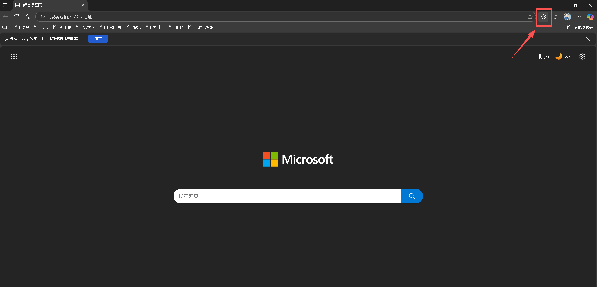
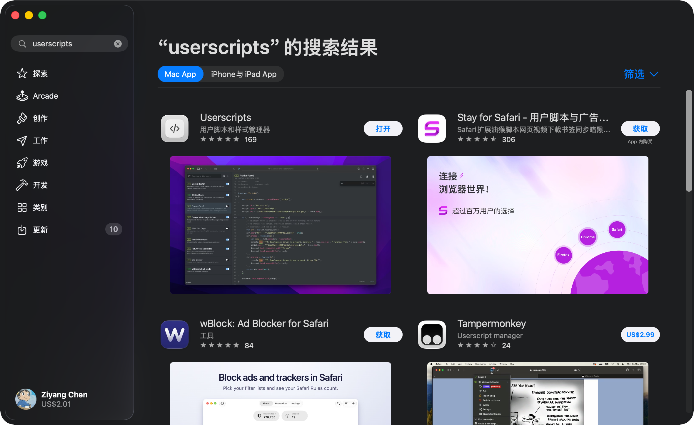
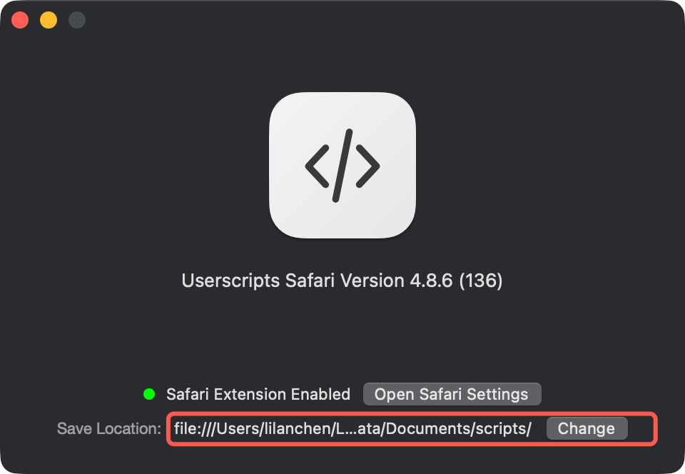
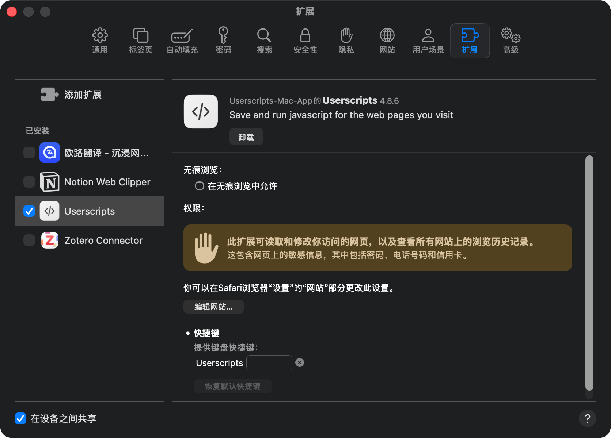
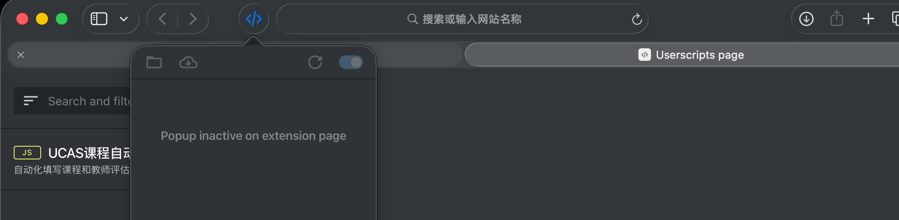
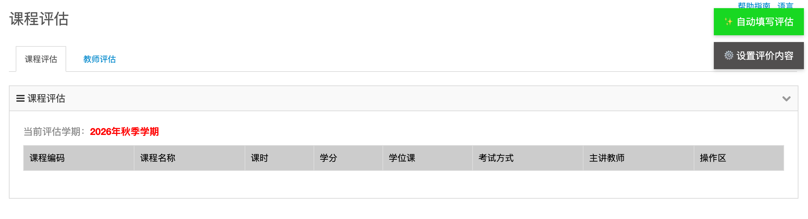
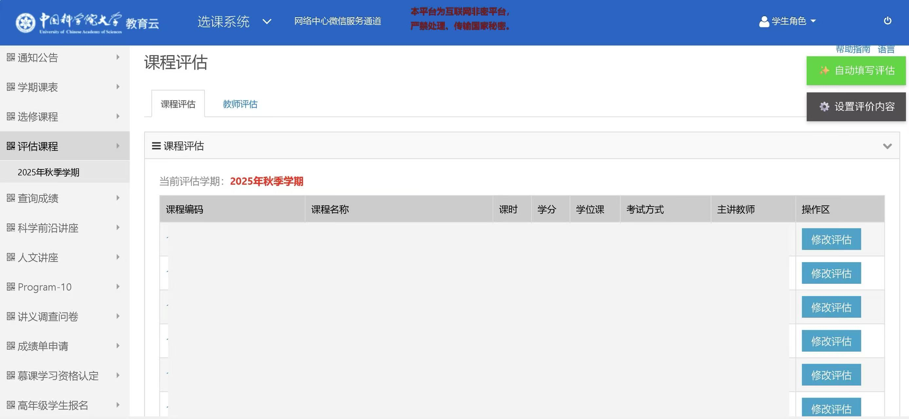
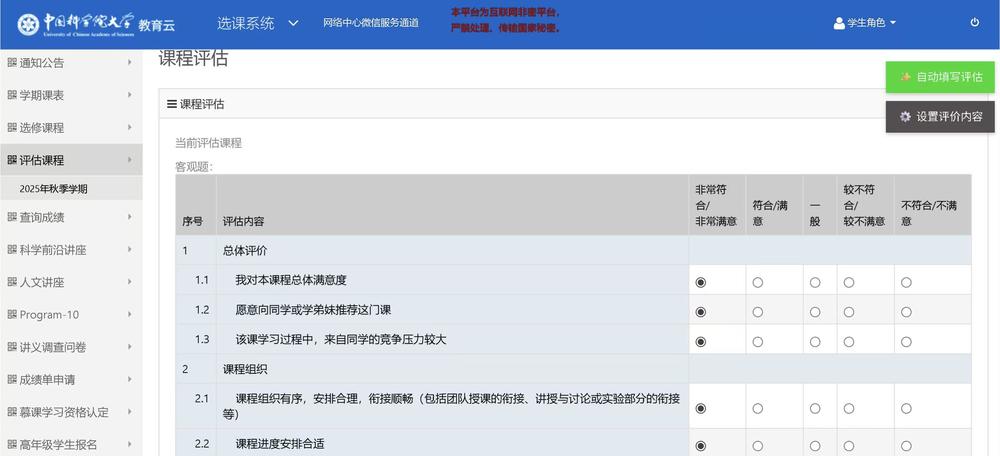
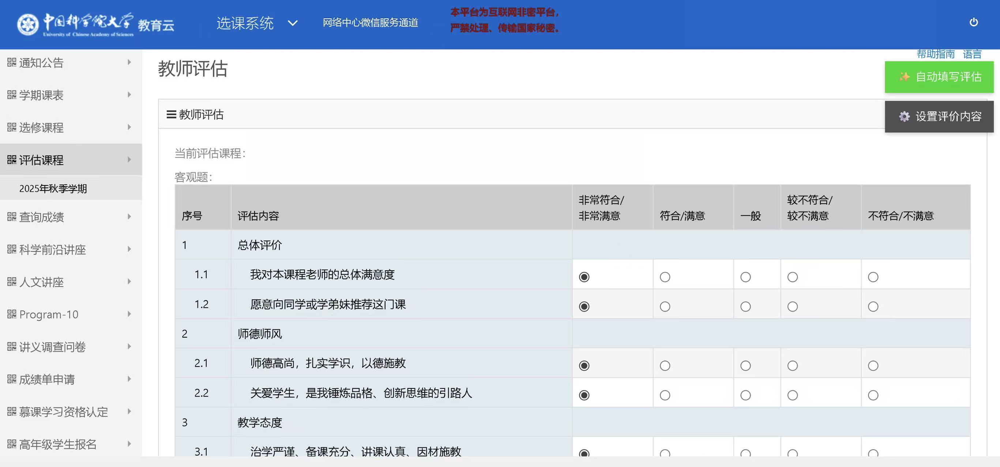
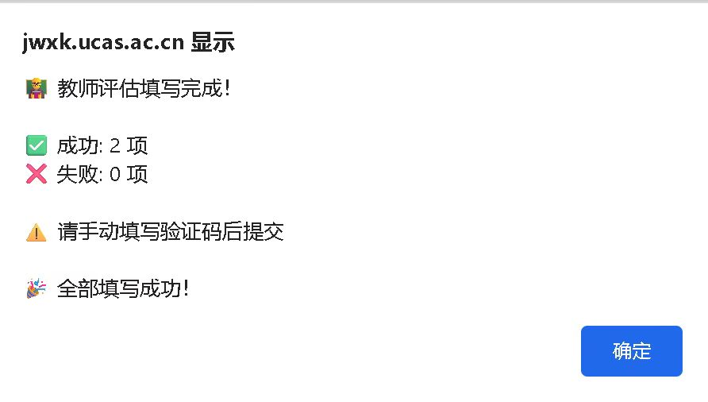

**Ps：有朋友私信，就安利一下我现在在用的梯子，比较好用。可以进行全局代理，节点稳定。无痛访问ChatGPT(OpenAI)、Claude、Google Gemini等AI工具，感兴趣的朋友可以试一试~**

[https://gw1.mao2cli.com/#/register?code=alCAcVJE](https://gw1.mao2cli.com/#/register?code=alCAcVJE)

---

## Star History

---

# 国科大课程评价工具-懒人版

> **脚本功能：自动化填写课程和教师评估问卷 - 智能识别文本框，支持 Windows / macOS（Edge、Chrome、Safari）**

> 又到了半年一度的果壳课评环节，每当一门课程进度过半时就会开启课评。每节课的课评用鼠标一个一个点确实很麻烦，更不必说一些多教师参与授课的大课还得对每一位老师评价，因此就想在github上找找看有没有之前学长学姐们写的脚本，可惜SEP评课系统有所更新，现有脚本不能直接使用，因此我准备重新写一个适配25FALL的油猴脚本，供果壳的大家使用~

> 在此我向大家保证，0基础小白也能轻松上手

---

**26/11/08更新**

**课评插件 3.0 版本上线！这是一次重大更新：**

- **正式支持 Apple 生态（Mac）**：除 Chrome / Edge 外，现在也可以在 Safari 中使用，教程见 [Mac Safari 用户专区](#mac-safari-用户专区)
- **修复了「已打开开发人员模式，右上角仍没有按钮」的问题**：新版浏览器还需要勾选「允许用户脚本」，见步骤二
- **移除了 2.0 中已不再使用的验证码识别依赖**，脚本加载更快，国内网络下也更稳定

---

**25/12/27更新**

**根据同学们的反馈，更新了课评插件2.0版本，取消了正确率不高的本地验证码识别，让课评更加丝滑。**

---

**25/11/26更新**

**狡猾的教务处把课评网址子域名改了，导致之前的插件不能用了，目前已更新，请大家放心使用**

---

# 步骤一

虔诚地在心中默念，我爱国科大，国科大爱我，伟大的果壳神会保佑每一个在果壳的学子。

**注：这点很重要，不能跳过！**

---

# 步骤二

**安装油猴**

这里无论是Edge还是Chrome浏览器都大差不差，我以Edge浏览器为例

打开一个新的页面，点击扩展 - 获取 Microsoft Edge 扩展

搜索TamperMonkey，点击第一个绿色的软件，安装即可（我装过了）

接着，点击扩展 - 篡改猴 旁边的··· - 管理扩展

一定要确认开发人员模式被打开，否则脚本没办法正常运行

**⚠️ 新版浏览器（Chrome 138+ / 新版 Edge）还需要额外一步：** 在扩展管理页找到 篡改猴 - 详细信息，勾选 **「允许用户脚本」（Allow User Scripts）**，并把站点访问权限设为「在所有站点上」。只开开发人员模式、不勾这个选项，右上角是不会出现按钮的（浏览器自动更新后"突然不能用"一般也是这个原因）。

**Mac 用户：**

- Chrome / Edge：步骤和 Windows 完全一样，记得勾选上面的「允许用户脚本」
- Safari：跳过步骤二，按步骤三下载好脚本后，直接看 [Mac Safari 用户专区](#mac-safari-用户专区)
- 文中提到的 F12 在 Mac 上对应 ⌘+⌥+I

这一步就到这里结束了

---

# 步骤三

**从 GitHub 下载脚本**

打开下面的网址：

[https://github.com/21White/UCAS-Course-Evaluate-SillyTool](https://github.com/21White/UCAS-Course-Evaluate-SillyTool)

页面长这样：

接着，点击绿色按钮Code，并点击Download ZIP

然后你就下载了一个压缩包.zip文件

解压这个文件，得到

ok，这一步就先到这里

- [ ] **这里麻烦大家帮我点一个Star！这对我很重要！谢谢！**

---

# 步骤四

接下来我们将脚本导入油猴

点击扩展 - 篡改猴 - 管理面板

点击 实用工具 - 导入（选择文件）- 选择解压后文件夹中的.js脚本 - 安装

这样我们所有的准备工作就全部完成了，下面让我们打开SEP网站开始实操！

---

# Mac Safari 用户专区

**用 Chrome / Edge 的同学请跳过这一节。** Safari 用户用这一节代替步骤二和步骤四（脚本文件请先按步骤三下载并解压）。

**1. 安装 Userscripts**

打开 App Store，搜索 **Userscripts**，安装第一个（免费）。旁边的 Tampermonkey 在 Safari 上是付费的，不需要买。

**2. 打开 Userscripts App**

安装后打开一次 Userscripts App。窗口下方的 **Save Location** 就是存放脚本的文件夹，记住它，第 4 步要用。

**3. 在 Safari 中启用扩展**

点左上角 **Safari浏览器 - 设置…**（或直接点上图的 Open Safari Settings），进入 **扩展** 标签页

勾选左侧的 **Userscripts**，再点 **编辑网站…**，把国科大的网站（或「访问其他网站时」）设为 **允许**

**4. 导入脚本**

以下两种方式任选其一：

- 在访达中按 ⌘+⇧+G，粘贴 `~/Library/Containers/com.userscripts.macos.Userscripts-Extension/Data/Documents/scripts`（即第 2 步的 Save Location），把解压得到的 `.js` 脚本复制进这个文件夹
- 点击 Safari 工具栏上的 `</>` 图标 - 打开扩展页面 - 左上角 **+** - **New JS**，把 `.js` 脚本的全部内容粘贴进去，按 ⌘+S 保存

完成后在扩展页面里能看到 **UCAS课程自动评估脚本**，就说明导入成功了

**5. 开始使用**

打开 SEP 的课程评估页面，右上角出现 **✨ 自动填写评估** 和 **⚙️ 设置评价内容** 两个按钮，就说明一切正常，接着看步骤五即可。第一次访问时如果 Safari 询问是否允许 Userscripts 访问该网站，请选择 **始终允许**。

---

# 步骤五

打开国科大SEP网站，找到课评板块。点击课程/教师评估，进入评估页面

设置评价内容中，你可以看到我的代码中预设好的评价，我强烈建议你**稍微改改**，别果壳所有人都用一个（我对传播广度还是太自信了hhhh，之后的教师评价也一样。

修改完记得**保存设置，如果卡bug了请点击重置默认**

如果发现页面右上角没有这些按钮，请回到步骤二，看看有没有打开油猴的**开发人员模式**，以及有没有勾选**允许用户脚本**！！！

好的，如果一切顺利脚本会自动填写，稍微等一下就能显示填写成功。失败也不要怕，刷新一下就行，

# 步骤六

**(1.0版本)**
点击识别验证码，大概3~5秒即可自动识别并填写，如正确提交即可！
由于识别验证码部分没有调用模型识别，仅为图像处理，因此准确率不高，你可以选择**刷新验证码重新点击识别 或 自己输入（笑）**

**(2.0版本)**
**更新后不再有验证码本地识别功能，请自行输入！**

 点击保存，这样就大功告成了！

最后还是：

# **麻烦大家帮我点一个Star！这对我很重要！谢谢！**

---
